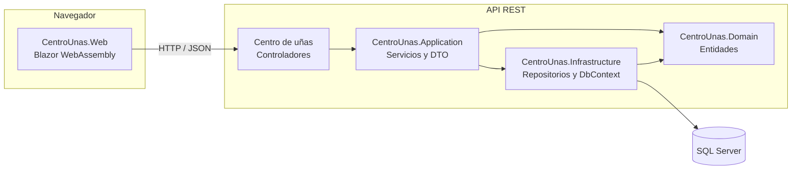
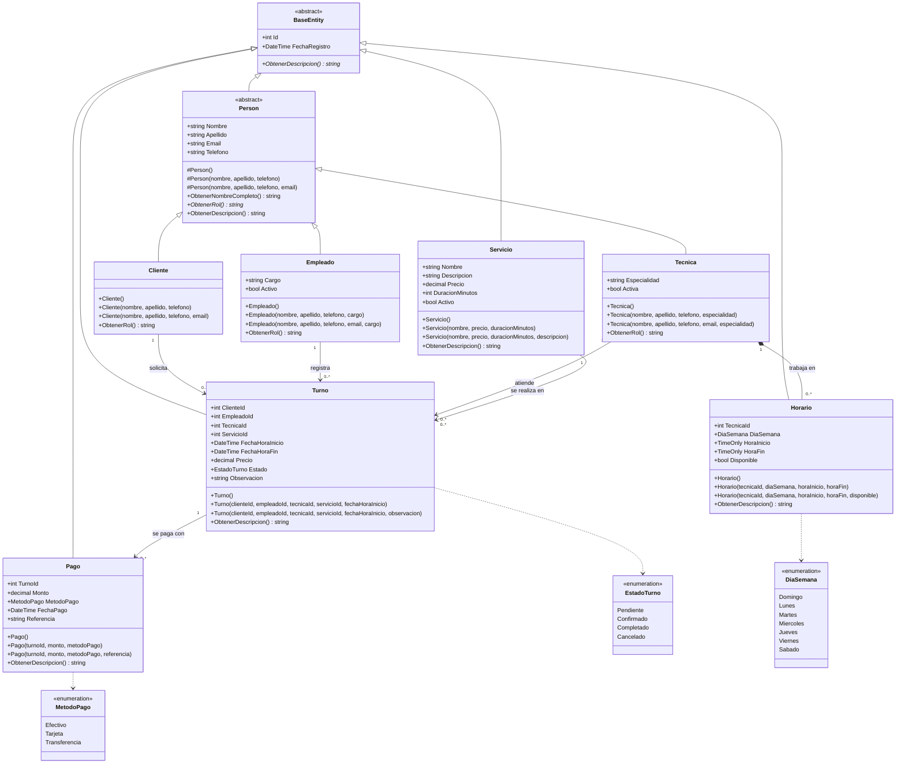
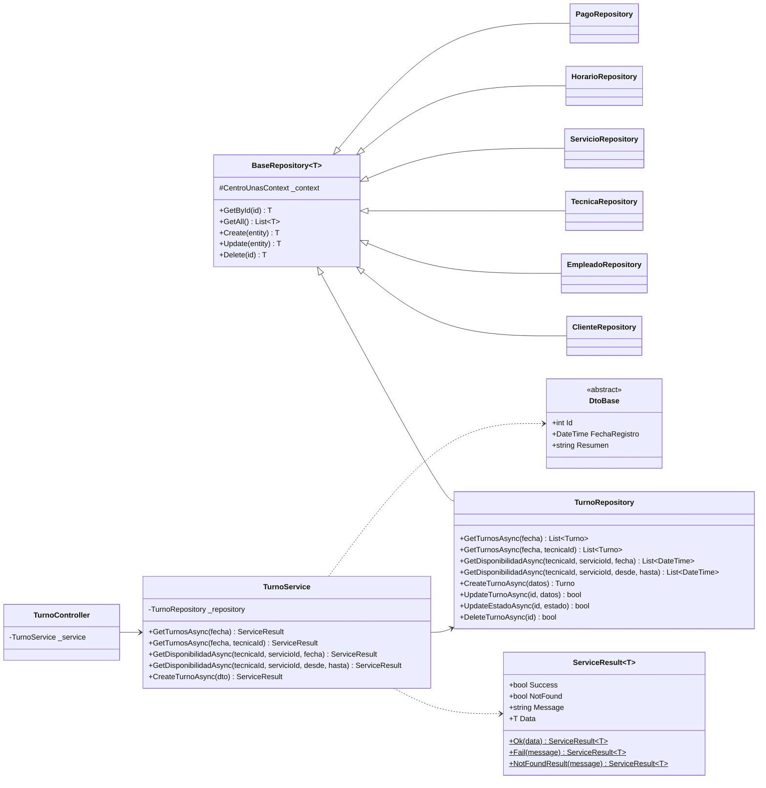

# Centro de Uñas: Sistema de Turnos

Sistema para gestionar los turnos de un centro de uñas. Permite registrar clientes, técnicas, empleados y servicios, definir el horario de trabajo de cada técnica, agendar turnos solo en horas libres y registrar los pagos de cada turno.

Proyecto final de Programación 2, hecho por Raquel Andrea Soriano Cespedes.

## Idea del proyecto

En un centro de uñas los turnos suelen anotarse en una libreta o por mensajes. Eso provoca dos clientes a la misma hora con la misma técnica, turnos fuera del horario de trabajo y pagos que no se sabe a qué servicio corresponden.

Este sistema resuelve eso:

- **Agenda sin choques:** solo se puede agendar en una hora en la que la técnica trabaja y no tiene otro turno.
- **Búsqueda de horarios libres:** para un día o para un rango de hasta 31 días, según la duración del servicio.
- **Seguimiento del turno:** cada turno pasa por los estados Pendiente, Confirmado, Completado o Cancelado.
- **Control de pagos:** un turno puede pagarse en partes, pero nunca por encima de su precio.
- **Registro de quién atendió:** cada turno guarda el empleado que lo registró.

### Objetivos

1. Evitar turnos duplicados o fuera del horario de la técnica.
2. Tener en un solo lugar los clientes, servicios, turnos y pagos.
3. Aplicar los conceptos de Programación Orientada a Objetos en un sistema real con base de datos, capas separadas y un frontend independiente.

## Tecnologías

| Parte | Tecnología |
|---|---|
| Backend | ASP.NET Core 9 Web API con Swagger |
| Base de datos | SQL Server con Entity Framework Core 9 (migraciones) |
| Frontend | Blazor WebAssembly (.NET 9) con Bootstrap |
| Lenguaje | C# |

## Arquitectura

La solución tiene cinco proyectos. El frontend y la API son aplicaciones separadas que se comunican por HTTP (arquitectura distribuida cliente-servidor), y la API está dividida en capas.



| Capa | Proyecto | Responsabilidad |
|---|---|---|
| Presentación | `CentroUnas.Web` | Páginas que ve el usuario. Llama a la API con `ApiService`. |
| API | `Centro de uñas` | Controladores REST, CORS y Swagger. |
| Aplicación | `CentroUnas.Application` | Servicios que convierten entidades en DTO y devuelven un `ServiceResult`. |
| Infraestructura | `CentroUnas.Infrastructure` | `DbContext`, migraciones, repositorios y reglas de negocio. |
| Dominio | `CentroUnas.Domain` | Entidades, clases abstractas y enumeraciones. |

## Diagrama de clases

### Dominio



Los métodos marcados con `*` son abstractos. `Email`, `Descripcion`, `Observacion` y `Referencia` son opcionales.

### Capas de la API



Los otros recursos (Cliente, Empleado, Técnica, Servicio, Horario y Pago) siguen el mismo esquema que Turno: un controlador, un servicio y un repositorio.

## Conceptos de POO aplicados

| Concepto | Dónde se aplica |
|---|---|
| **Clases normales** | Las entidades `Cliente`, `Empleado`, `Tecnica`, `Servicio`, `Horario`, `Turno` y `Pago` (`CentroUnas.Domain/Entities`), además de repositorios, servicios y controladores. |
| **Constructores** | Cada entidad tiene un constructor vacío (lo usa Entity Framework) y constructores con parámetros. Los servicios y repositorios crean los objetos con ellos, por ejemplo `new Cliente(nombre, apellido, telefono, email)`. |
| **Encadenamiento de constructores** | Las clases hijas llaman al padre con `: base(...)` (`Cliente` → `Person`) y las versiones largas reutilizan la corta con `: this(...)`. |
| **Clases abstractas** | `BaseEntity` y `Person` en el dominio, `DtoBase` en Application, y `DtoBase` y `PersonaDto` en el frontend. |
| **Métodos abstractos** | `BaseEntity.ObtenerDescripcion()` lo implementan todas las entidades. `Person.ObtenerRol()` lo implementan `Cliente`, `Empleado` y `Tecnica`. El resultado llega al usuario en el campo `Resumen`. |
| **Sobrecarga de métodos** | `TurnoRepository` y `TurnoService`: `GetDisponibilidadAsync` (un día o un rango) y `GetTurnosAsync` (por fecha o por fecha y técnica). En el frontend, `ApiService.GetAsync` y `ApiService.PutAsync`. Los constructores también están sobrecargados. |
| **Herencia** | `Cliente`, `Empleado` y `Tecnica` heredan de `Person`, que hereda de `BaseEntity`. Los repositorios heredan de `BaseRepository<T>`. |
| **Polimorfismo** | `ObtenerDescripcion()` se llama igual en cualquier entidad y cada una responde con su propio texto. |
| **Encapsulamiento** | `ServiceResult<T>` y `ApiResult<T>` tienen setters privados y solo se crean con `Ok`, `Fail` o `NotFoundResult`. Los repositorios exponen `_context` solo a sus clases hijas (`protected`). |
| **Genéricos** | `BaseRepository<T>`, `ServiceResult<T>` y `ApiResult<T>`. |

## Reglas de negocio

- Un turno solo se agenda en el futuro, dentro de un horario disponible de la técnica.
- La técnica no puede tener dos turnos que se crucen, y el cliente tampoco.
- La técnica, el empleado y el servicio del turno deben estar activos.
- La hora de fin se calcula con la duración del servicio y el precio se copia del servicio.
- Un turno completado o cancelado ya no se puede modificar, y un turno con pagos no se puede cancelar ni eliminar.
- Un pago no puede superar el saldo pendiente del turno ni registrarse en un turno cancelado.
- Los horarios de una técnica no pueden cruzarse, y la hora de inicio debe ser menor que la de fin.
- El correo de clientes, técnicas y empleados no se puede repetir.
- No se puede eliminar un cliente, técnica, empleado o servicio que tenga turnos.

## Endpoints principales

Todos los recursos tienen `GET`, `GET /{id}`, `POST`, `PUT /{id}` y `DELETE /{id}` en `api/Cliente`, `api/Empleado`, `api/Tecnica`, `api/Servicio`, `api/Horario`, `api/Turno` y `api/Pago`. Además, Turno tiene:

| Método | Ruta | Descripción |
|---|---|---|
| `GET` | `api/Turno/fecha/{fecha}?tecnicaId=` | Turnos de un día, opcionalmente de una técnica |
| `GET` | `api/Turno/disponibilidad?tecnicaId=&servicioId=&fecha=` | Horas libres de un día |
| `GET` | `api/Turno/disponibilidad/rango?tecnicaId=&servicioId=&desde=&hasta=` | Horas libres en un rango de hasta 31 días |
| `PUT` | `api/Turno/{id}/estado` | Cambia el estado del turno |

La documentación completa está en Swagger: `http://localhost:5228/swagger`.

## Cómo ejecutarlo

### Requisitos

- .NET SDK 9
- SQL Server (la cadena de conexión usa `Server=(local)` con autenticación de Windows)
- Visual Studio 2022 (opcional)

### Pasos

1. Clonar el repositorio.
2. Revisar la cadena de conexión en `Centro de uñas/Centro de uñas/appsettings.Development.json`.
3. Crear la base de datos con las migraciones:

   ```
   cd "Centro de uñas"
   dotnet ef database update --project CentroUnas.Infrastructure --startup-project "Centro de uñas"
   ```

4. Iniciar la API y el frontend:
   - **Visual Studio:** abrir `Centro de uñas.sln`, elegir el perfil de inicio **API + Web** y presionar F5.
   - **Terminal:** en dos terminales distintas, desde la carpeta `Centro de uñas`:

     ```
     dotnet run --project "Centro de uñas" --launch-profile http
     dotnet run --project CentroUnas.Web --launch-profile http
     ```

5. Abrir el frontend en `http://localhost:5024`. La API queda en `http://localhost:5228`.

El frontend busca la API en la dirección de `CentroUnas.Web/wwwroot/appsettings.json`, y la API solo acepta llamadas de las direcciones de `Cors:Origenes` en su `appsettings.json`. Si se cambia algún puerto, hay que actualizar los dos archivos.

## Estructura del repositorio

```
Centro de uñas/
├── Centro de uñas/              API: controladores, Program.cs, appsettings
├── CentroUnas.Application/      Servicios, DTO y ServiceResult
├── CentroUnas.Domain/           Entidades, clases abstractas y enumeraciones
├── CentroUnas.Infrastructure/   DbContext, migraciones, repositorios y excepciones
└── CentroUnas.Web/              Frontend en Blazor WebAssembly
    ├── Core/                    ApiResult y enumeraciones
    ├── Dtos/                    DTO con validaciones
    ├── Pages/                   Inicio, Turnos, Pagos y CRUD de cada recurso
    ├── Services/                ApiService (cliente HTTP)
    └── Shared/                  Componentes reutilizables
```
